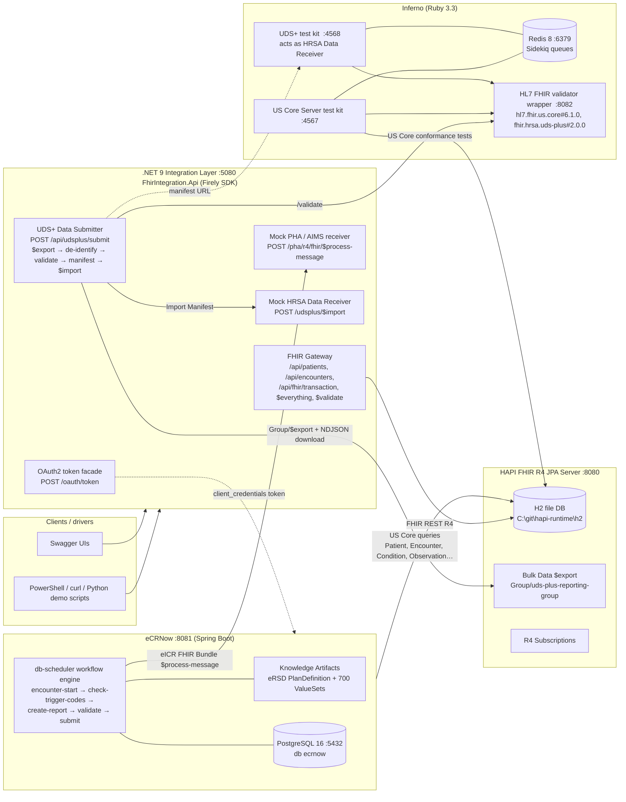

# Solution architecture

## 1. Context

The assessment asked for a working local stack of four interoperability technologies (HAPI FHIR,
eCRNow, UDS+, Inferno) plus a .NET integration layer, with evidence of FHIR operations, eCR
integration, conformance testing and UDS+ understanding. The workstation constraints shaped the
design: **Windows 11, no Docker, no WSL, no administrator rights**. Every component therefore runs as
a plain process from portable binaries under `C:\git\tools`, orchestrated by
`scripts\start-all.ps1`.

## 2. Component diagram

## 3. Runtime topology on the workstation

| Component | Technology | Port | Process / start command | State |
| --- | --- | --- | --- | --- |
| PostgreSQL 16.9 | EDB portable binaries | 5432 | `pg_ctl -D C:\git\tools\pgdata start` | `ecrnow`, `inferno` databases |
| Redis 8.10 | redis-windows (msys2 build) | 6379 | `redis-server --port 6379` | in-memory only |
| HAPI FHIR JPA starter 8.12.0 | Spring Boot WAR, JDK 21, H2 file DB | 8080 | `java -jar target\ROOT.war --spring.config.additional-location=file:C:/git/hapi-runtime/application-local.yaml` | persistent H2 under `hapi-runtime\h2` |
| eCRNow (master, Release 3.x/4.x code line) | Spring Boot WAR, JDK 21 | 8081 | `java -Dsecurity.key=… -Djdbc.username=postgres -Djdbc.password=postgres -jar target\ecr-now.war --spring.config.additional-location=file:C:/git/ecrnow-runtime/application-local.properties` | PostgreSQL |
| HL7 validator wrapper 1.0.85 | Ktor/Jetty, JDK 21 | 8082 | `java -jar validator-wrapper.jar` | package cache `%USERPROFILE%\.fhir\packages` |
| Inferno US Core test kit | Ruby 3.3 + Puma + Sidekiq | 4567 | `bundle exec puma` / `bundle exec sidekiq -r ./worker.rb` | SQLite `data\inferno_development.db` |
| Inferno UDS+ test kit 1.3.0 | Ruby 3.3 + Puma + Sidekiq | 4568 | same, `INFERNO_PORT=4568`, `REDIS_URL=…/1` | SQLite |
| .NET integration layer | ASP.NET Core 9 minimal API + Firely `Hl7.Fhir.R4` | 5080 | `dotnet run --project dotnet\FhirIntegration.Api` | file output under `results\dotnet-output` |

## 4. Key design decisions

1. **Gateway / facade pattern for the .NET layer.** Rather than letting every consumer speak raw
   FHIR, the .NET service exposes task-oriented endpoints (patients, encounters, UDS+ submission)
   and hides FHIR details (search parameters, paging, Bundle handling) behind the Firely SDK's
   `FhirClient`. The same service doubles as (a) an OAuth2 client-credentials token issuer so that
   eCRNow's SMART "System" authentication path works against an open development server, and (b) the
   public-health receiving endpoint, which keeps the whole demonstration self-contained.
2. **HAPI as the single data source.** Both eCRNow and the UDS+ submitter read from the same HAPI
   instance, which mirrors a production EHR FHIR façade (for Greenway this would be the AWS
   HealthLake data store). HAPI is configured with `client_id_strategy: ANY` so sample data can use
   stable, human-readable ids, and with Bulk Data export enabled because UDS+ depends on it.
3. **eCRNow driven by `launchPatient` rather than Subscriptions.** The eRSD workflow starts from an
   *encounter-start* named event. Using the REST launch API mirrors how an EHR integration engine
   would notify eCRNow and avoids needing HAPI subscriptions to call back into eCRNow (both are
   supported; subscriptions are enabled on HAPI for completeness).
4. **Inferno run natively on Windows.** Inferno officially supports Docker/WSL only. It was made to
   work natively by installing Ruby 3.3 with the MSYS2 toolchain, adding the `ffi` gem (needed by
   `rest-client` on Windows), replacing Redis 5 with a Redis 8 build (Sidekiq 7 requires `HELLO`),
   and pointing `FHIR_RESOURCE_VALIDATOR_URL` at the standalone validator-wrapper jar.
5. **UDS+ realised as a pipeline, not a product.** HRSA publishes an IG and a test kit, not a server.
   The .NET submitter implements the Data Submitter + de-identification actors end to end and uses
   Inferno's UDS+ kit as the HRSA receiver, which is exactly how a vendor would validate before the
   annual submission.

## 5. Data flow walkthroughs

### 5.1 Basic FHIR operations
`sample-data/transaction-bundle.json` (19 US Core resources) → `POST /fhir` (transaction) → reads,
searches (`Patient?family=`, `Condition?patient=&code=`, `_revinclude`), `$everything`, `$validate`.
Driven either with curl or through the .NET gateway endpoints.

### 5.2 eCR
`POST /api/healthcareSettings` (register HAPI) → `POST /api/addKARStatus/` (activate eRSD, output
`FHIR`) → `POST /api/launchPatient` → eCRNow queries HAPI for Condition/Observation/… → matches
SNOMED 840539006 against `ValueSet/dxtc` → `create-report` builds the eICR bundle → `submit-report`
POSTs `$process-message` to the .NET PHA mock → mock returns a Reportability-Response-style
acknowledgement. Artefacts: `ecrnow-runtime\bsa-output\*.json`, `results\dotnet-output\eicr\`.

### 5.3 UDS+
`POST /api/udsplus/submit?groupId=uds-plus-reporting-group&validate=true` → HAPI `Group/$export`
(async) → NDJSON download → de-identification (pseudonymous ids, age extension, stripped
identifiers) → UDS+ profile tagging → validator wrapper with `fhir.hrsa.uds-plus#2.0.0` → NDJSON
hosted at `/udsplus/files/{run}/` → Import Manifest → `$import` to the .NET receiver mock and, for
conformance evidence, to the Inferno UDS+ kit.

### 5.4 Conformance
Inferno US Core Server suite (`us_core_v610`, FHIR API group) against `http://localhost:8080/fhir`
with `patient_ids=demo-patient-1`; Inferno UDS+ suite with the generated manifest.

## 6. Production considerations (beyond the PoC)

- Replace the H2 store with PostgreSQL for HAPI, or point the .NET layer at AWS HealthLake using
  SigV4-signed requests (the gateway already isolates all FHIR access behind one service).
- Replace the OAuth facade with a real authorization server (SMART Backend Services with
  asymmetric client assertions); eCRNow supports this through `authType: SofBackend` and
  `jwks.keystore.location`.
- Terminate eCR transport with Direct/XDR or the AIMS FHIR endpoint; register a real
  `PublicHealthAuthority` in eCRNow.
- Harden the UDS+ de-identification (salted/tokenised pseudonyms held in a vault, date shifting,
  ZIP-3 generalisation) and run the validator plus Inferno kit in CI.
- Observability: eCRNow already writes per-step debug artefacts; add structured logging and
  OpenTelemetry in the .NET layer.
